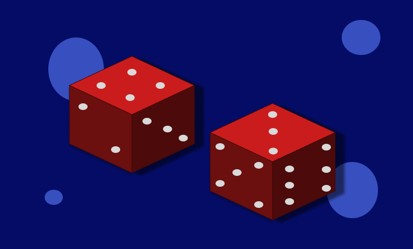

# Two Dice Done Rigorously: Sigma-Algebras, Pushforward Measures, Random Variables, and Why 7 Wins (Part 3 of 3)

Not by ai badges will eventually go here

*This is the third and final installment in the series. I highly recommend reading both the first and second if you haven't already:*
- *Part 1: https://medium.com/@mckenzieben15/two-dice-done-rigorously-sigma-algebras-pushforward-measures-random-variables-and-why-7-wins-0379d5513631*
- *Part 2: https://medium.com/@mckenzieben15/two-dice-done-rigorously-sigma-algebras-pushforward-measures-random-variables-and-why-7-wins-0379d5513631*
## Brief Recap
In the first article we learned about the probability space tuple, that our probability space is a measurable space equipped with a probability measure, and what a sigma algebra on a set is. In the second article, we learned about preimages and measurable functions, and how a random variable is a measurable function from our underlying probability space, to the space of adding our dice rolls together. We finished that article off with an example relating all the concepts together.

In this article, we will tie all the concepts we've used together, and **finally** answer our question: *"Why does 7 win when rolling two dice and taking their sum?"*
## Defining our Probability Measure
Define the measure itself, make note that this is from the domain side of our random variable. This is simply the cardinality of our event divided by the cardinality of our sample space.

To start, we need to define the probability measure of our underlying probability space (the left side of our random variable). We learned in the first article that our underlying probability space is the measure space:
$$
\begin{aligned}
&\hspace{3em}(\Omega,\mathcal{F},\mathcal{P})\\
&\Omega:\text{ is our sample space}\\
&\mathcal{F}:\text{ is our event space}\\
&\mathcal{P}: \text{ is our probability measure}
\end{aligned}
$$
*figure 1*

While we did give an overview of our probability measure and the qualities it has (*figure 14 in article 1*) we didn't actually define what values it takes. Here is where will will do so!

Recall the "rules" that our probability measure adheres to:
$$
\begin{aligned}
&1.\ \mathcal{P}\left(\bigcup_{i=1}^\infty E_i\right)=\sum_{i=1}^\infty\mathcal{P}(E_i)\text{ where all }E_1,E_2\dots\in\mathcal{F}\text{ are pairwise disjoint}\\
&2.\ \mathcal{P}(\emptyset)=0\\
&3.\ \mathcal{P}(\Omega)=1, \text{ the measure of the sample space is } 1\\
&4.\ \mathcal{P}:\mathcal{F}\rightarrow[0,\infty]\text{ (it's a measure and therefore nonnegative)}
\end{aligned}
$$
*figure 14 from article 1*

Now, we know that our sample space is an element of our event space, and we also know that the elements of our event space are subsets of our sample space. The question we want our probabiliy measure to answer is:
$$
\text{What are the chances of }E\in\mathcal{F}\text{ happening?}
$$
### A Bit of Intuition
To build a bit of intuition before defining our probability measure formally, first recall what our sample space is:
$$
\Omega=\{\omega=(i,j):i,j\in\{1,2,3,4,5,6\}\}
$$
*Figure 2*

Next, we can ask ourselves, *how many elements are there in our sample space?* The answer 36. We arrive at this by noting for every 1st die roll, there are 6 possible ways to roll the second die. Since there are 6 possible ways to roll the first die, we have: 6x6=36.

With the observation above, we know that the chances of getting **one specific pair of values** is then 1/36. Here is a quick quiz: *What are the chances of getting 3 specific pairs of dice rolls?*

The answer...... 3/36. This will be the case for any number, we simply **divide the number of specific pairs of dice rolls by 36, the total number of pairs we have**. We need to relate this back to our formal framework though.

### Formal Definition of Our Probability Measure
We can state this formally as:
$$
$$
*Figure 3*
### Our Underlying Probability space
conclusion where we show our probability space tuple. This would be the measurable space associated with the left side of our random variable.